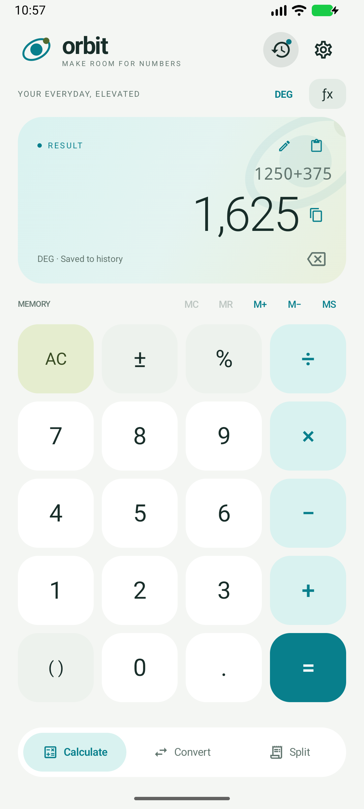
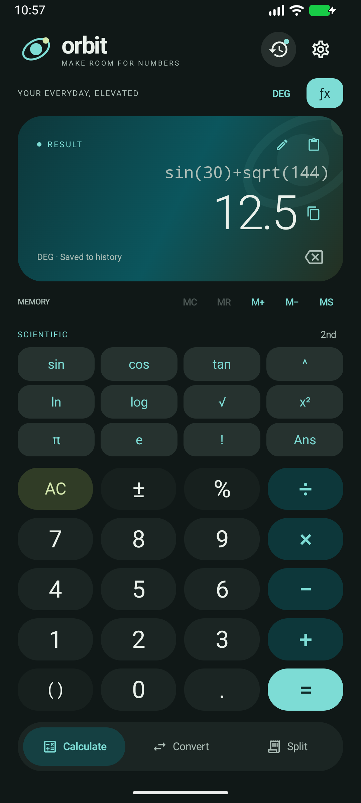
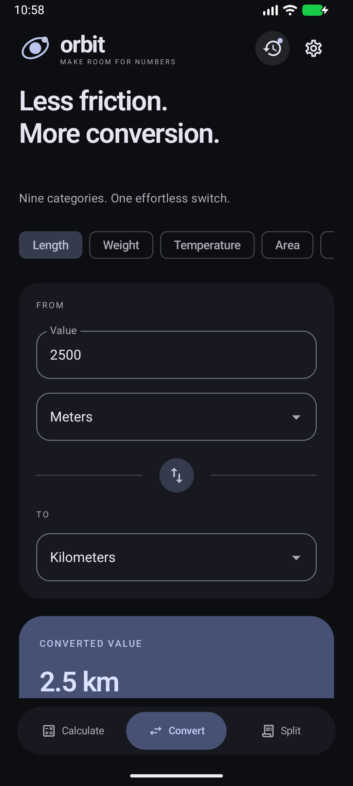
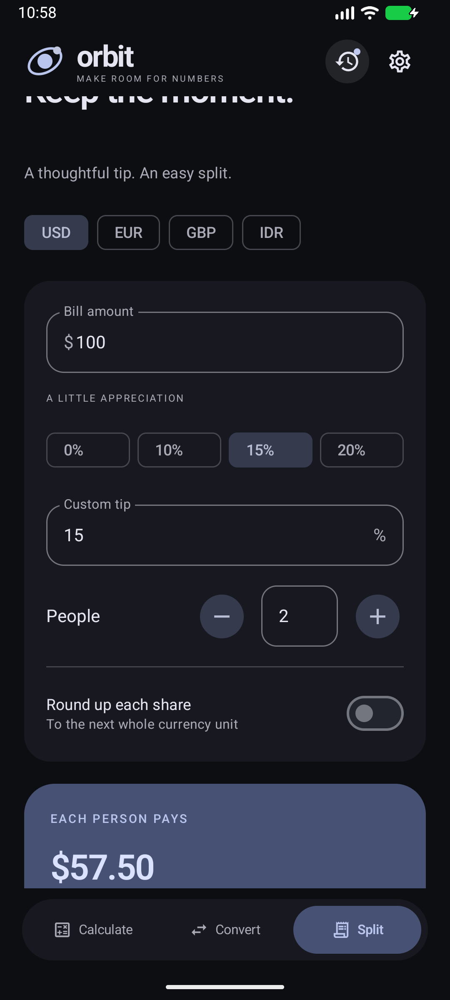

# Orbit — website + Android calculator

https://dntestproject.github.io/orbit-calculator/

The public marketing site for **Orbit**, a private, offline Android calculator, together
with the app it advertises. The site is a hand-built static experience: a scroll-driven
Three.js "calculator slab" that flies through the page, a phone UI rendered in
HTML/CSS/SVG, a working bill-splitter demo backed by Orbit's own expression engine, and
a design system built on a pixel display font and a strict editorial grid.

Everything is local. The site makes **no network requests** at runtime.

- **Website** — `index.html` + five static subpages + `css/style.css` + bundled `js/app.js`
- **App** — `assets/app/Orbit-1.0.0-debug.apk`, served by `download.html`
- **Version** — site 1.0.0, app 1.0.0 (min Android 8.0 / API 26, target/compile SDK 36)

## Preview

| Homepage | Scientific, dark | Converter | Bill splitter |
| --- | --- | --- | --- |
|  |  |  |  |

## Run it

Requires Node 18+.

```bash
npm install
npm run build      # bundles src/* into js/app.js via esbuild
npm run dev        # static server on http://localhost:4173
```

`npm run dev` serves the built site from the repo root. Re-run `npm run build` after
editing anything in `src/`. The HTML, CSS and `assets/` are served as-is — no copy step.

To deploy, publish the repository root to any static host. Every link, script, font and
image path is relative, so GitHub Pages, Netlify, Cloudflare Pages and a plain nginx
document root all work with no configuration. `js/app.js` is committed, so a host without
a build step serves the site correctly.

## The website, page by page

| Page | What it does |
| --- | --- |
| `index.html` | The whole narrative: loader, hero, three scroll chapters, safety, privacy, interactive demo, reviews, download CTA, footer |
| `download.html` | APK download, three-step install, requirements |
| `technology.html` | How the expression engine works — grammar, bounded evaluation, formatting, exact money maths |
| `roadmap.html` | What ships next |
| `privacy.html` | What stays on device, what Orbit never does |
| `terms.html` | Licence, warranty, liability, privacy, updates |
| `changelog.html` | Release notes and the verification record for 1.0.0 |

### Homepage beats

1. **Loader** — a pixel tile grid wipes away, the Orbit mark flies to its header
   position, then the hero reveals. Skipped instantly for `prefers-reduced-motion`.
2. **Hero** — *"A better way to do the math"* in the pixel display face, with the slab
   floating in a WebGL slot beside it.
3. **Three chapters** — *Type any expression, watch it solve* / *Keep every result within
   reach* / *From simple sums to steep math*. Each chapter pins, and the slab re-poses as
   you scroll past it.
4. **Safety** — a pinned, rule-crossing statement section with its own scrub timing.
5. **Privacy** — pinned statements that slide across the grid; pixel marks are generated
   from a seeded PRNG on load.
6. **Try it yourself** — the live demo (below).
7. **Reviews** — a field of quote plates drifting at different scroll speeds.
8. **Download CTA** — QR code generated in the browser, no external QR service.
9. **Footer** — oversized wordmark and site links.

### How the motion is built

There is no animation framework. Everything is hand-written and driven by one ticker:

- **Scroll source** — [Lenis](https://github.com/darkroomengineering/lenis) for smooth
  wheel/touch scrolling, with native scroll as the fallback under reduced motion.
- **Pinning** — CSS `position: sticky` plus a `--hold-h` spacer driven by a `data-hold`
  attribute in viewport units. No GSAP pin, no layout hack — the page height is stable and
  identical across reloads.
- **One frame loop** — `tick()` in `src/main.js` reads scroll position once, then updates
  the story poses, phone states, rule/tone inversion, progress dot, pixel grids and each
  pinned section's progress. Every component is a pure function of scroll progress, so
  state never accumulates.
- **Scroll choreography** — `data-slot` elements mark where the 3D slab should sit; the
  matching pose is resolved in `updateStory()` and the slab springs toward it.
- **Text** — `src/scramble.js` decodes glyph-scramble headlines per character;
  `splitLines()` / `revealLines()` wrap and stage line reveals without a split-text plugin.
- **Buttons** — `src/pixelButton.js` inverts a tile grid on hover/focus, matching the
  loader.
- **Extras** — a custom cursor, an idle state that dims the chrome, and a page-cover wipe
  for internal navigation.

### The WebGL slab

`src/story.js` and `src/cardModel.js` build the floating object: a **six-piece Orbit
calculator slab** whose display, brand face and key labels are drawn to canvas and used as
textures. The slab is one fixed canvas projected onto whichever `[data-slot]` is active,
so it can travel the page while staying a single WebGL context. Bloom, shadows, pose
interpolation and per-piece springs are all in that module. Nothing is imported from the
app and no third-party model is used — the geometry is generated.

The slab's display is **live**: when the bill-splitter demo updates, the slab rewrites its
expression, result and status line to match.

### The phone UI

`src/phone.js` injects a device frame and a rendered Orbit screen into every
`[data-slot^="phone"]` mount, using inline SVG and HTML. It is a static depiction of the
real app's UI, not an embedded Android runtime.

### Try it yourself (the demo)

`src/tryit.js` is a real feature, not a video:

- Bill amount, currency (USD / EUR / GBP / IDR), and a party of 3–6 people.
- Money is parsed to integer minor units and split exactly, with **ceiling shares** so the
  collected total always covers the bill — the same rule the app uses.
- Each person's card has a copy action; the copied summary is formatted per currency.
- The section has three phases (`create` → `shares` → copy state) that also drive the
  slab display and the surrounding scroll choreography.

## Design system

- **Type** — `PixelOperator` for display headlines (free pixel font) and `Geist` for body
  (SIL OFL), both self-hosted in `assets/fonts`. No font CDN.
- **Grid** — a single `--u` unit derived from a fixed 1728-unit design width, so every
  spacing, rule and font size scales from one number and the layout recomposes rather than
  breaks at other widths.
- **Palette** — ink `#121212` on paper `#fff`, with one accent chosen per page load from a
  five-entry palette. Sections invert to dark as the scroll passes them, and rules fade in
  and out accordingly.
- **Rules** — hairline grid lines that cross the page and invert under the slab and the
  phone, built entirely from CSS custom properties.

## The Android app

Orbit is a complete Android calculator in Kotlin and Jetpack Compose: an expression
calculator, scientific keypad, persistent history, unit conversion and a bill splitter in
one animated, Material You-ready interface.

### Calculate

- Live preview while typing; `=` commits the result and saves it to history.
- Full expression grammar: `+ − × ÷ ^`, parentheses, factorial `!`, percent `%`, implicit
  multiplication (`2π`, `2(3+4)`, `2sin(30)`), constants `π` and `e`, and `Ans`.
- Editable expression field for long or pasted formulas, with clipboard paste.
- Repeating `=` repeats the last binary operation; typing a digit after a result starts a
  new calculation.
- Scientific panel with a 2nd bank: trig and inverse trig, `ln`, `log`, `√`, `x²`, `xʸ`,
  `∛`, `eˣ`, `10ˣ`, `1/x`, `abs`, `π`, `e`, `!`, `Ans`.
- DEG/RAD mode with exact quadrant handling (`sin 180° = 0`, not `1.2E-16`).
- Memory: `MC`, `MR`, `M+`, `M−`, `MS`, persisted across restarts.
- History: last 100 results, searchable, with reuse, use-result, copy and delete.
- Hardware keyboard support: digits, operators, Enter, Backspace, Escape.
- Safe evaluation: bounded length and nesting, domain checks, no divide-by-zero,
  non-finite results rejected, human-readable errors.
- Formatting: 4–12 decimal precision, optional digit grouping, scientific notation for
  very large or small values, full-precision internals.

### Convert

- Nine categories: length, weight, temperature, area, volume, speed, time, data, energy.
- 50+ units including US volume measures and decimal vs binary data units.
- Affine temperature conversion with absolute-zero validation, one-tap swap.

### Split

- Tip presets and custom percentage, 1–100 people, optional round-up per share.
- Exact `BigDecimal` money maths, `CEILING` shares so the bill is always covered.
- USD / EUR / GBP / IDR labels and a copy-ready summary.

### Make it yours / private by design

- System, light or dark theme; four accent palettes; Material You wallpaper colours on
  Android 12+; haptics, digit grouping and precision controls.
- Animated key presses, tab and panel transitions, responsive portrait and landscape,
  edge-to-edge drawing.
- No internet permission, no ads, no accounts, no analytics. History, memory and settings
  stay on-device; backups and device transfer are excluded.

### Engine and tests

The engine and conversion layers are pure Kotlin with no Android dependencies, so they are
unit-tested on the JVM. State is exposed with Compose `mutableStateOf` from an
`AndroidViewModel`; history and settings persist as JSON in `SharedPreferences`.

- **137 JVM tests** — grammar, precedence, functions, domains, formatting boundaries, all
  unit conversions, money rounding, split invariants.
- **26 emulator tests** — arithmetic, live preview, scientific/radian, memory, history
  search and reuse, persistence across activity restarts, tab-state retention, converters,
  split rounding, error paths, hardware keyboard, landscape rotation, theme switching,
  Material You, plus visual capture.
- Debug APK is ~18 MB; the unsigned release build is ~1.5 MB.

### App behaviour notes

- `%` is a direct divide-by-100: `200 + 10%` is `200.1`. For a 10% increase use
  `200 × (1 + 10%)`. This is stated in Settings.
- Trig functions respect DEG/RAD; inverse trig returns in the active mode.
- Currency selection changes the display symbol only, not conversion rates.
- History is capped at 100 entries; clearing it leaves memory and settings intact.

## Project structure

```
index.html              homepage (loader, hero, chapters, safety, privacy, demo, reviews, CTA, footer)
download.html           APK download + install steps
technology.html         engine notes
roadmap.html            release plan
privacy.html            privacy notes
terms.html              terms
changelog.html          release notes
css/style.css           design system, tokens and every component
src/main.js             loader, Lenis, scroll choreography, scramble, pixel transitions, cursor, idle, page cover
src/story.js            Three.js scene: bloom, pose solver, scroll poses, piece springs
src/cardModel.js        the calculator slab: six pieces, display, keys, textures
src/tryit.js            "Try it yourself" bill splitter demo
src/scramble.js         glyph-scramble text effect
src/pixelButton.js      tile-inversion buttons
src/phone.js            phone frame + Orbit app UI injected into every phone mount
js/app.js               built bundle (esbuild, committed)
scripts/build.mjs       esbuild entry
scripts/serve.mjs       dependency-free static server (PORT env, default 4173)
assets/fonts            PixelOperator (free pixel font) + Geist (OFL)
assets/images           screenshots and social cards
assets/app              Orbit 1.0.0 debug APK served by the download page
```

## Stack

- **Runtime** — plain ES modules, no framework, no TypeScript build.
- **Bundler** — esbuild (`npm run build` → IIFE, `es2020`, minified, no sourcemap).
- **Dependencies** — `three` (WebGL scene), `lenis` (smooth scroll),
  `qrcode-generator` (in-browser QR on the CTA).
- **Server** — `scripts/serve.mjs`, Node `http` only, no dev-server dependency.

## Notes

- `index.html` is self-contained apart from `js/app.js`; subpages are static HTML plus the
  shared CSS.
- Pinned sections are CSS sticky plus a `--hold-h` spacer, not a GSAP pin — scroll height
  is deterministic (14,406 px at 1440×900).
- All assets are local; the site performs no network requests and loads no third-party
  scripts.
- The layout is a behaviour-level recreation of a marketing site's *feel* for the Orbit
  app. No target code, images, 3D models or branding are used; the slab, the phone UI and
  every graphic are generated here, and only open-licensed fonts are bundled.
- The APK in `assets/app` is a debug build for sideloading. Because it is a binary in git,
  rebuilding it on every release will grow the repository quickly — move it to a GitHub
  Release asset if that becomes a habit.
